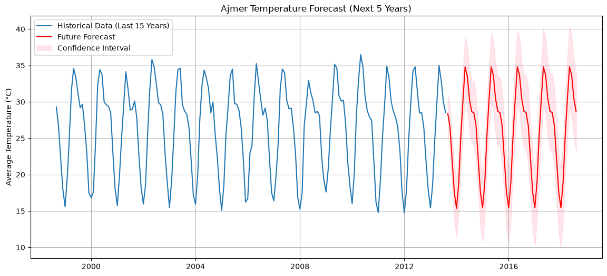
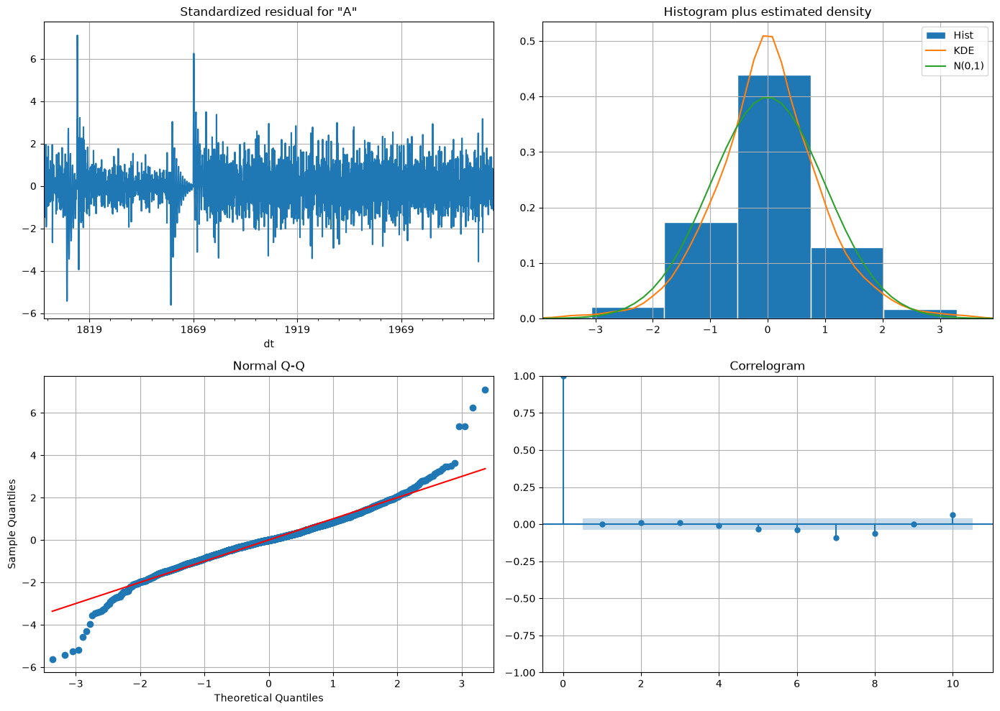
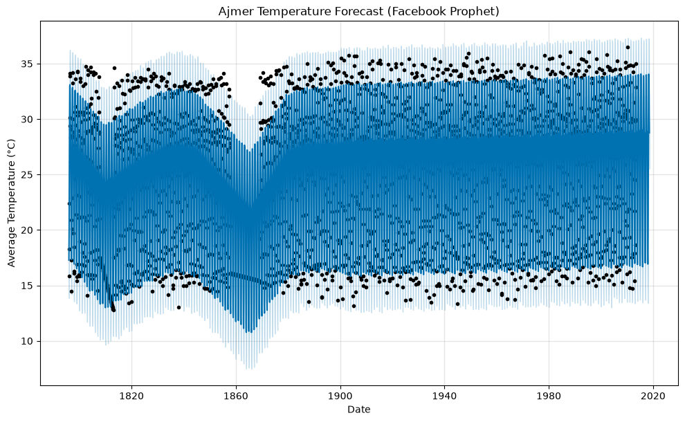

# Ajmer Time Series Analysis

This project forecasts a 5-year temperature trajectory for Ajmer, India, comparing statistical models (SARIMA) against curve-fitting models (Facebook Prophet).

### 5-Year Temperature Forecast (SARIMA)

### SARIMA Diagnostics
I verified the model successfully captured seasonal patterns leaving only random noise:

### Facebook Prophet Forecast
Notice how Prophet handles the massive 1860s missing data gap by widening its confidence interval:

